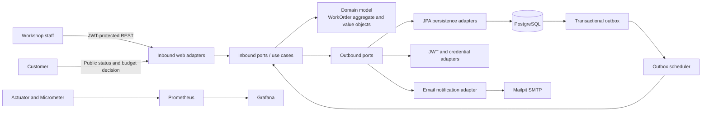

# Workshop Management API

An end-to-end backend for managing an automotive workshop, from customer and vehicle registration through diagnosis, budget approval, inventory allocation, service execution, and delivery. Built with **Java 21**, **Spring Boot**, **PostgreSQL**, pragmatic **Domain-Driven Design (DDD)**, and **Hexagonal Architecture**, it shows how business rules, transactional consistency, asynchronous notifications, observability, automated tests, and deployment infrastructure fit together in a production-style modular monolith.

## Architecture diagram



The domain and application layers have no Spring, JPA, or HTTP dependencies. Spring configuration acts as the composition root that connects use cases to REST, persistence, security, notification, and observability adapters.

## Key engineering highlights

- Models the full work-order lifecycle: `RECEIVED` → `IN_DIAGNOSIS` → `WAITING_APPROVAL` → `IN_EXECUTION` → `FINALIZED` → `DELIVERED`, with `BUDGET_REJECTED` as an explicit outcome.
- Keeps lifecycle transitions, pricing, stock validation, and ownership rules inside the domain.
- Separates business policy from frameworks through inbound/outbound ports and explicit mappings.
- Protects budget approval and stock deduction with database locks and transactions.
- Makes public budget approval retry-safe through persisted idempotency records.
- Uses a transactional outbox that safely distributes notification work across scheduler replicas.
- Ships Docker Compose and local Kubernetes environments with PostgreSQL, Mailpit, Prometheus, and Grafana.
- Validates code, coverage, Docker, Terraform, and Kubernetes manifests in GitHub Actions.

## Technology stack

| Area | Technologies |
| --- | --- |
| Language and runtime | Java 21, Maven |
| Application | Spring Boot 3.5, Spring Web MVC, Jakarta Bean Validation |
| Persistence | PostgreSQL 16, Spring Data JPA, Hibernate, Flyway |
| Security | Spring Security, JWT (JJWT), BCrypt |
| API documentation | Springdoc OpenAPI, Swagger UI |
| Observability | Spring Boot Actuator, Micrometer, Prometheus, Grafana |
| Testing | JUnit 5, AssertJ, Mockito, Spring Boot Test, H2, Testcontainers, JaCoCo |
| Platform | Docker, Docker Compose, Kubernetes, Kind, Kustomize, HPA |
| Infrastructure and CI | Terraform, GitHub Actions |

## Architecture and design decisions

### Domain-Driven Design

`WorkOrder` is the central aggregate and owns its service and part line items. It enforces status transitions, recalculates monetary totals, and reserves stock only after budget approval. `DocumentNumber` and `VehiclePlate` are value objects that normalize and validate Brazilian CPF/CNPJ identifiers and legacy/Mercosur plates. `Part` encapsulates inventory rules and minimum-stock behavior.

This is pragmatic DDD within a modular monolith: aggregate boundaries, value objects, domain behavior, and ubiquitous language without distributed-service complexity.

### Hexagonal Architecture

- `adapters/in/web` translates HTTP requests into application commands and results into DTOs.
- `application/port/in` defines the operations exposed by the application.
- `application/usecase` coordinates domain objects, transactions, and outbound ports without framework imports.
- `application/port/out` abstracts repositories, transactions, tokens, credentials, and notifications.
- `adapters/out` implements those contracts with JPA, PostgreSQL, Spring Security, JWT, and SMTP.
- `configuration` wires the implementation through Spring beans.

An architecture test prevents application classes from importing Spring, JPA, or web-adapter types. The rationale and trade-offs are recorded in [ADR 0001](docs/adr/0001-arquitetura-hexagonal.md).

PostgreSQL supplies relational constraints and transaction semantics. Flyway owns schema evolution, while Hibernate uses `ddl-auto=validate`. Monetary values use fixed-precision decimal columns and entities use UUID identifiers.

## Reliability patterns

### Concurrency control

- `PartJpaEntity` uses optimistic versioning with `@Version`.
- Stock mutations acquire pessimistic write locks.
- Budget approval locks the work order and its parts in stable UUID order, reducing races and deadlock risk.
- Stock validation, deduction, status transition, and idempotency completion share one transaction.

### Idempotency

Public budget approval accepts an optional `Idempotency-Key`. PostgreSQL enforces uniqueness for `(operation, idempotency_key)`, while `INSERT ... ON CONFLICT DO NOTHING` arbitrates concurrent requests across replicas. A SHA-256 hash binds the key to the operation, work-order code, and normalized customer document. Reuse with different input returns `409 Conflict`; a completed retry returns the current result without deducting stock again.

Idempotency currently covers `POST /api/v1/public/work-orders/{code}/budget/approve` only.

### Transactional outbox

Budget notifications are inserted into `notification_outbox` in a transactional application flow. Workers claim short batches with `FOR UPDATE SKIP LOCKED`, move rows through `PENDING`, `PROCESSING`, `SENT`, and `FAILED`, and retry failures up to a configurable limit. Stale claims become eligible again after a configurable timeout.

SMTP calls happen after the claim commits, avoiding long database locks. Delivery is **at least once**: failure after SMTP accepts a message but before `SENT` is recorded may cause a duplicate, so a production recipient or provider should support deduplication.

## Security

- Administrative routes require a signed JWT and stateless Spring Security sessions.
- Passwords are stored with BCrypt; a configurable local administrator is created on first startup.
- Public status and budget routes verify both work-order code and normalized customer document.
- Mismatched public lookup data returns the same not-found response, limiting discovery.
- Request DTOs enforce format, size, numeric, and required-field constraints.
- The Docker runtime uses a dedicated non-root user on an Alpine-based Java 21 JRE.
- Health, info, Prometheus, Swagger, and OpenAPI endpoints are intentionally public locally.

The checked-in credentials and JWT secret are demonstration defaults. Override them outside local use. A vulnerability-review artifact is available in the [security report](docs/relatorio-vulnerabilidades%20-%20Pedro%20Paulo.pdf).

## Observability

Actuator exposes health, info, application metrics, and a Prometheus endpoint. Custom Micrometer gauges report outbox rows by state. Prometheus and a provisioned Grafana dashboard cover API availability, HTTP throughput and latency, JVM memory, process CPU, and outbox health.

| Service | Local URL | Credentials |
| --- | --- | --- |
| Health | <http://localhost:8080/actuator/health> | Public |
| Prometheus metrics | <http://localhost:8080/actuator/prometheus> | Public |
| Prometheus | <http://localhost:9090> | None |
| Grafana | <http://localhost:3000> | `admin` / `admin` |
| Mailpit | <http://localhost:8025> | None |

## Testing strategy

- **Domain unit tests** exercise aggregates, value objects, validation, inventory, and lifecycle invariants without Spring.
- **Application tests** isolate use cases with mocks and cover conflict, failure, idempotency, and outbox retry paths.
- **Architecture tests** enforce the framework-independent application boundary.
- **Web tests** verify exception mapping and HTTP behavior.
- **PostgreSQL integration tests** use **Testcontainers** with PostgreSQL 16 for Flyway migrations, native claim queries, persistence, security, concurrency, and the main REST flow.
- **Fast Spring tests** use H2 where PostgreSQL-specific behavior is unnecessary.
- **Coverage enforcement** uses JaCoCo with an 80% minimum line ratio for critical domain packages during `verify`.

```bash
mvn clean verify
```

Docker must be running for the Testcontainers suites.

## Infrastructure

**Docker Compose** starts the API, PostgreSQL 16, Mailpit, Prometheus, and Grafana. The API image uses a multi-stage Maven build and a non-root Java 21 runtime.

**Kubernetes** manifests deploy the stack to local Kind through Kustomize. The API has startup, readiness, and liveness probes; resource requests/limits; ConfigMap and Secret injection; and an init container that waits for PostgreSQL.

The `autoscaling/v2` **Horizontal Pod Autoscaler (HPA)** scales the API from 1 to 3 replicas at 70% average CPU or 75% average memory. Metrics Server is required for these metrics; a Kind setup script is included. The HPA targets only the API.

**Terraform** provisions the **local Kind environment**: cluster creation, API image build/load, Kustomize apply, and deployment waits. It does not provision cloud infrastructure, remote state, a registry, or a managed database. See the [local Terraform guide](infra/terraform/local/README.md).

The main GitHub Actions workflow runs Maven verification, uploads JaCoCo output, builds the Docker image, validates Terraform, and renders Kubernetes manifests. A manual Kind smoke workflow deploys the stack and checks the HPA, API health, and metrics.

## How to run locally

### Docker Compose

Requirements: Docker with Compose support and free ports `3000`, `5432`, `8025`, `8080`, `9090`, and `1025`.

```bash
git clone <repository-url>
cd workshop-management-api
docker compose up --build -d
curl http://localhost:8080/actuator/health
```

Expected response: `{"status":"UP"}`. Open Swagger UI at <http://localhost:8080/swagger-ui.html>. Local administrator credentials are `admin` / `admin123`.

```bash
# Preserve PostgreSQL data
docker compose down

# Also permanently remove the local database volume
docker compose down -v
```

### Maven

With Java 21, Maven, and PostgreSQL available:

```bash
docker compose up -d postgres mailpit prometheus grafana
mvn spring-boot:run
```

Configuration variables are listed in [.env.example](.env.example).

### Local Kubernetes

Requires Docker, Kind, `kubectl`, and Terraform 1.6+:

```bash
./scripts/terraform-local-apply.sh
export KUBECONFIG="$(terraform -chdir=infra/terraform/local output -raw kubeconfig_path)"
./scripts/k8s-install-metrics-server.sh
./scripts/k8s-port-forward.sh
```

Destroy it with `./scripts/terraform-local-destroy.sh`. Direct Kind scripts also exist under `scripts/`; use one provisioning workflow at a time because both target `oficina-local`.

## Example API flow

This uses seeded catalog IDs plus `curl` and `jq`, and assumes Docker Compose is running.

```bash
# 1. Authenticate.
TOKEN=$(curl -s http://localhost:8080/api/v1/auth/login \
  -H 'Content-Type: application/json' \
  -d '{"username":"admin","password":"admin123"}' | jq -r '.accessToken')

# 2. Create a work order; the customer and vehicle are created when absent.
ORDER=$(curl -s http://localhost:8080/api/v1/admin/work-orders \
  -X POST -H "Authorization: Bearer $TOKEN" \
  -H 'Content-Type: application/json' \
  -d '{
    "customer":{"fullName":"Alex Morgan","documentType":"CPF",
      "documentNumber":"52998224725","email":"alex@example.com","phone":"+5511999999999"},
    "vehicle":{"plate":"ABC1D23","brand":"Toyota","model":"Corolla","manufacturingYear":2022},
    "services":[{"serviceId":"11111111-1111-1111-1111-111111111111","quantity":1}],
    "parts":[{"partId":"bbbbbbbb-bbbb-bbbb-bbbb-bbbbbbbbbbbb","quantity":1}],
    "diagnosticNotes":"Oil and filter replacement"
  }')
ORDER_ID=$(printf '%s' "$ORDER" | jq -r '.id')
ORDER_CODE=$(printf '%s' "$ORDER" | jq -r '.code')
printf '%s' "$ORDER" | jq '{id,code,status,totalAmount}'

# 3. Add the budget email to the transactional outbox.
curl -s -X POST -H "Authorization: Bearer $TOKEN" \
  "http://localhost:8080/api/v1/admin/work-orders/$ORDER_ID/budget/notify" | jq

# 4. Approve as the customer. Repeating this request/key is safe.
curl -s -X POST -H 'Content-Type: application/json' \
  -H "Idempotency-Key: approve-$ORDER_CODE-001" \
  -d '{"document":"52998224725"}' \
  "http://localhost:8080/api/v1/public/work-orders/$ORDER_CODE/budget/approve" | jq

# 5. Finish, deliver, and query public status.
curl -s -X POST -H "Authorization: Bearer $TOKEN" \
  "http://localhost:8080/api/v1/admin/work-orders/$ORDER_ID/finish" | jq '.status'
curl -s -X POST -H "Authorization: Bearer $TOKEN" \
  "http://localhost:8080/api/v1/admin/work-orders/$ORDER_ID/deliver" | jq '.status'
curl -s "http://localhost:8080/api/v1/public/work-orders/$ORDER_CODE/status?document=52998224725" | jq
```

The scheduled worker normally sends within five seconds. View local mail at <http://localhost:8025>, or trigger processing through the authenticated `POST /api/v1/admin/notifications/outbox/process` endpoint.

## Project structure

```text
.
├── src/main/java/br/com/fiap/techchallenge/oficina
│   ├── adapters
│   │   ├── in/web                 # REST controllers, DTOs, HTTP mapping
│   │   └── out                    # JPA, SMTP, JWT, and metrics adapters
│   ├── application
│   │   ├── port/in                # Use-case contracts and results
│   │   ├── port/out               # Infrastructure contracts
│   │   └── usecase                # Application orchestration
│   ├── configuration              # Spring composition root
│   └── domain                     # Aggregates, value objects, business rules
├── src/main/resources/db/migration # Flyway SQL migrations
├── src/test                        # Unit, architecture, web, integration tests
├── k8s                             # Kind and Kubernetes/Kustomize manifests
├── infra/terraform/local           # Local Kind provisioning module
├── observability                   # Prometheus and Grafana configuration
├── scripts                         # Kubernetes and Terraform automation
└── docs                            # ADRs, diagrams, studies, and reports
```

## Technical documentation

- [ADR 0001 — Hexagonal Architecture](docs/adr/0001-arquitetura-hexagonal.md)
- [Application architecture](docs/images/arquitetura-aplicacao.png), [infrastructure](docs/images/infraestrutura-provisionada.png), and [deployment flow](docs/images/fluxo-deploy-execucao.png)
- [Local Terraform guide](infra/terraform/local/README.md)
- [Solution diagrams](docs/diagrams.pdf), [ubiquitous language](docs/linguagem-ubiqua.pdf), and [Event Storming](docs/Event%20Storming%20Oficina%20Mecanica.pdf)
- [Security assessment](docs/relatorio-vulnerabilidades%20-%20Pedro%20Paulo.pdf)
- [Original challenge brief](docs/Tech%20Challenge%20FIAP-%20Pedro%20Paulo.pdf), [final report](docs/entrega-final-grupo-48-pedro-paulo.pdf), [presentation guide](docs/roteiro-apresentacao.pdf), and [presentation video](https://youtu.be/8tpXe1BIx18)

The OpenAPI contract is at <http://localhost:8080/v3/api-docs> and Swagger UI at <http://localhost:8080/swagger-ui.html> while the application runs.
